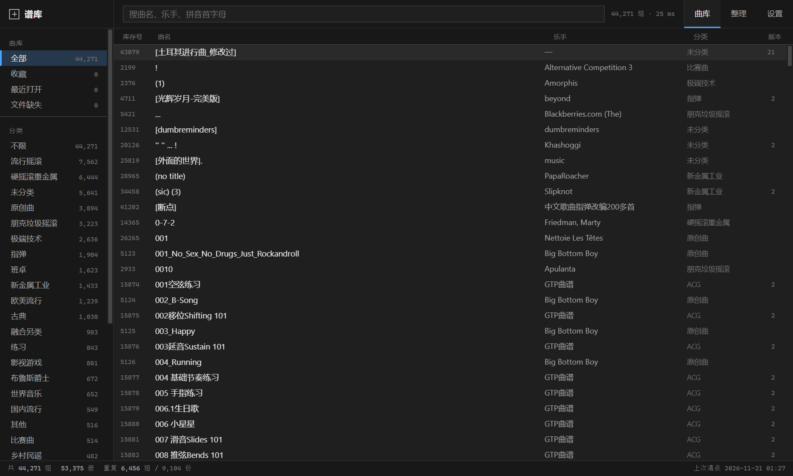
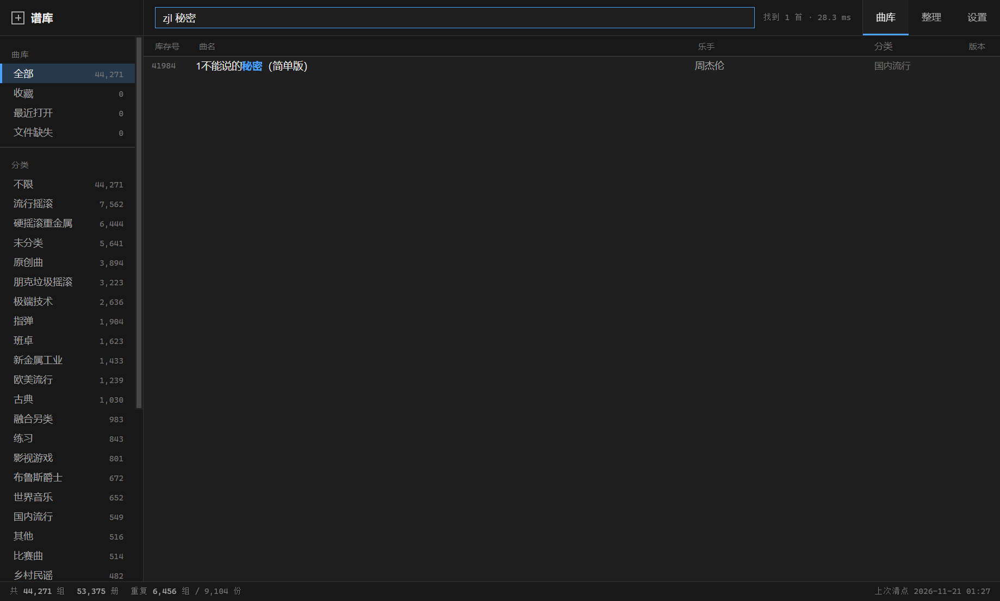
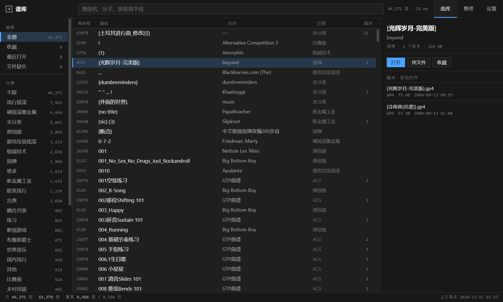

# 谱库 · GTP Search

把本机几万份 Guitar Pro 谱子变成一个能搜的曲库。打开、输入、双击、Guitar Pro 打开。



## 这东西解决什么

攒 Guitar Pro 谱子的人基本都会走到同一步：文件夹从几百个变成几万个，文件名五花八门，
`Beyond - 海阔天空.gp5` 和 `海阔天空(完美版).gp4` 和一堆编码坏成 `Aim閑` 的东西混在一起。
想弹某一首的时候，靠 Everything 搜文件名并不好使——你不知道自己当初存的是哪个写法。

这个软件只做一件事：**把文件名整理成"歌"，然后让你用任何写法搜到它。**

- 中文、英文、拼音全拼、拼音首字母、错拼、全角、带不带 `The`、带不带撇号，都能搜
- 同一首歌的十几个版本归成一条，点开看全部版本
- 按风格分类（跟着源目录走），能标收藏、看最近打开

## 界面

| 搜索 | 详情 |
|---|---|
|  |  |

## 装

去 [Releases](../../releases) 下 `GTP-Search-x.x.x-setup.exe`，双击安装。
Windows 10/11 x64。装完桌面有个「谱库」快捷方式。

第一次打开是空的，点「选目录」挑一个装着谱子的文件夹（或者它的上一层），加进来就开始清点。
支持 `.gp3 .gp4 .gp5 .gp .gtp .gpx`。

## 搜

输入框吃这几样，混着打也行：

| 你打 | 能搜到 |
|---|---|
| `海阔天空` | 同名曲 |
| `zjl` | 周杰伦（拼音首字母） |
| `zhoujielun` | 同上（全拼） |
| `zhoulun` | 同上（少打音节也兜得住） |
| `beyond 海阔` | Beyond 的海阔天空（两段分别命中乐手和曲名） |
| `guns n roses` | `Guns N' Roses`（撇号、全角撇号、`&`、`The` 都归一化过） |
| `ＢＥＹＯＮＤ` | 全角输入 |
| `aimée` / `aimee` | 两种写法一样 |

- 输入即搜，防抖 120ms，中文输入法上屏之后才查
- `↑↓` 选，`Enter` 打开，`Esc` 清空，`Ctrl+F` 回搜索框
- 命中的片段在曲名里换色标出（不是底色块）

## 别的

- **整理**：把库里的谱子按「分类/乐手」或「乐手」复制到一个新目录。只复制，不动源文件；先预演，看清冲突再开始。
- **设置**：加/移库目录、改 Guitar Pro 路径、开文件实时监听（默认关——几万个文件上开着会明显拖慢界面）。

## 实测数据

一台普通 Windows 机器，两个目录合计：

| | |
|---|---|
| 谱子文件 | 53,375 |
| 清点入库 | 11.7 秒（冷启动，含建库） |
| 归并成歌 | 44,271 |
| 有重复的歌 | 6,456 组 / 15,560 份 |
| 分类 | 32 个 |
| 搜索索引 | 44,271 条，157 ms 建好，9.4 MB 内存 |
| 单次查询 | 中位 10 ms |

搜索不查数据库：启动时把全部记录摊进内存线性扫一遍，数据库只在拿到 id 之后取整行。

## 技术栈

Electron 30 · React 18 · TypeScript · Vite · better-sqlite3 · chokidar · pinyin-pro · opencc-js

```bash
pnpm install
pnpm dev          # 开发
pnpm typecheck    # 类型检查
pnpm dist         # 打包，产物在 release/
```

pnpm 11 会跳过依赖的编译脚本，`pnpm-workspace.yaml` 里已经放行了 `better-sqlite3` / `electron` / `esbuild`。
`better-sqlite3` 需要针对 Electron 的 ABI 重编：

```bash
npm_config_target=30.5.1 npm_config_disturl=https://electronjs.org/headers \
npm_config_runtime=electron npm_config_arch=x64 pnpm rebuild better-sqlite3
```

打包时若卡在下载 electron，设 `ELECTRON_BUILDER_BINARIES_MIRROR=https://npmmirror.com/mirrors/electron-builder-binaries/`。

## 关于 AI

**这个项目从第一行代码到这份 README，全部由 AI 编写。**

需求、审美判断、验收标准由人给出并逐条验收（包括「搜索这个不合格，按规格重做」这种返工），
代码、数据结构、归一化规则、界面、打包脚本由 AI 实现。中间踩的坑——Guitar Pro 8 单实例
导致 spawn 打不开谱、pnpm 11 吞掉构建脚本、better-sqlite3 的 ABI 版本错位、PowerShell 按 GBK
读 UTF-8 把源码搞成乱码——都是边做边撞、边撞边修的。

代码里的注释和 commit message 都是中文，写得比较直白，能看出是边想边写的。

## 边界

- 不解析谱面内容，不渲染、不播放。乐手和曲名是从文件名和目录推出来的，推错的可以在详情页改
- 不联网、不上传、不分享、没有账号
- 不碰源文件。扫描只读，写入只发生在你指定的新目录（整理功能）

## 许可

[MIT](LICENSE)
